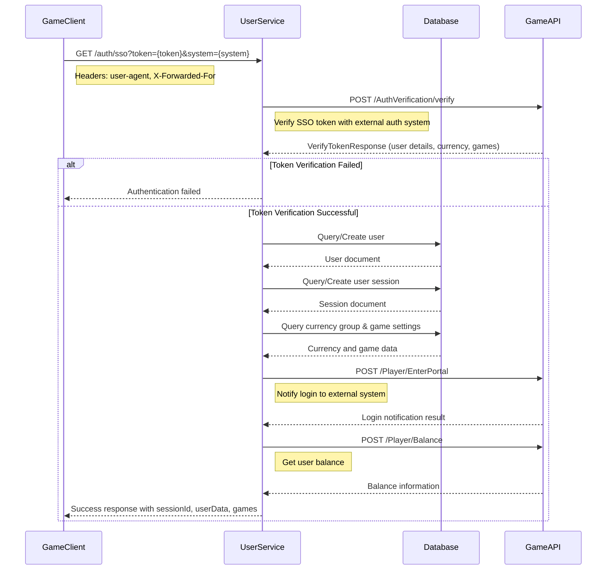
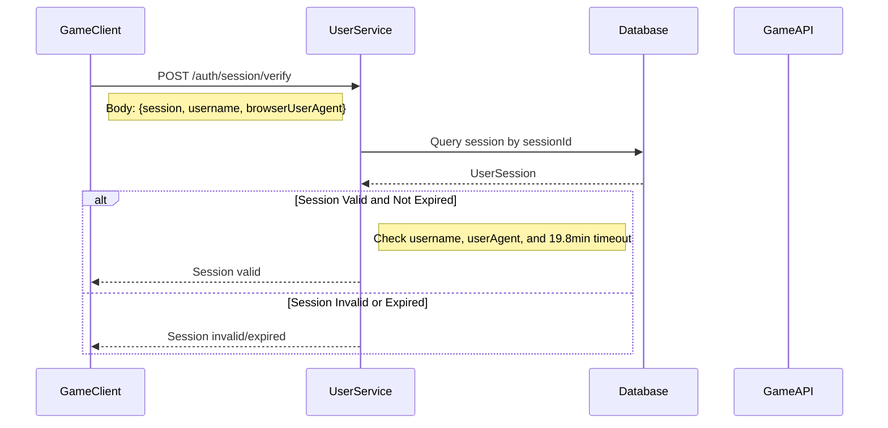
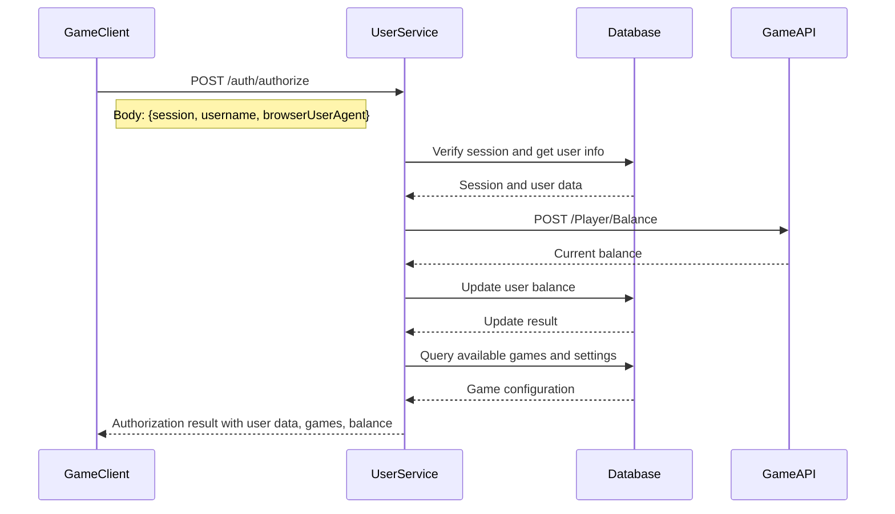
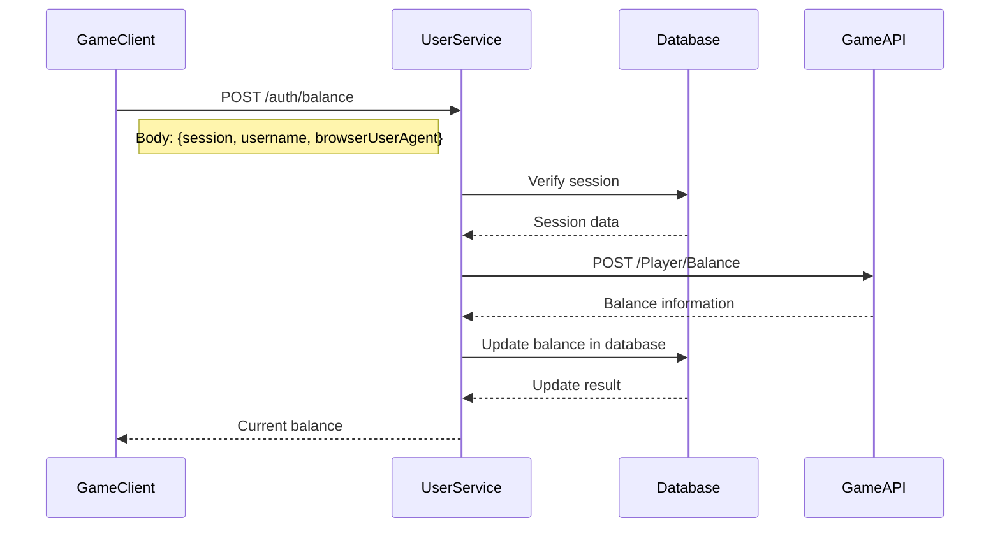

# User Service - Authentication Flow Documentation

## Overview

The User Service is a NestJS-based microservice that handles user authentication and session management for a gaming platform. It acts as a bridge between game clients and external authentication systems, providing secure user authentication, session management, and user data synchronization.

## Architecture Overview

```
┌─────────────┐    ┌──────────────┐    ┌─────────────┐    ┌─────────────┐
│ Game Client │───▶│ User Service │───▶│  Database   │    │  Game API   │
│             │    │              │    │             │    │             │
│ (Frontend)  │    │ (NestJS)     │    │ (MongoDB)   │    │ (Internal)  │
└─────────────┘    └──────────────┘    └─────────────┘    └─────────────┘
                                                              │
                                                              ▼
                                                       ┌─────────────┐
                                                       │ Operator API│
                                                       │ (External)  │
                                                       └─────────────┘
```

## Authentication Flow Overview

The authentication flow is divided into four main sections, each with its own sequence diagram and detailed explanation below.

## Main Flows

### 1. Initial SSO Authentication (`GET /auth/sso`)

This is the primary entry point for user authentication in the gaming platform. This section represents the primary authentication process when a user first accesses the gaming platform.

**Purpose**: Establishes initial user authentication and creates a session

**Key Steps**:

1. Game Client sends SSO token and system type
2. User Service verifies token with Game API
3. Creates or retrieves user from Database
4. Creates user session with 19.8-minute timeout
5. Fetches user balance and game settings
6. Returns session ID and user data to client

**Success Criteria**: Valid SSO token and successful user/session creation
**Failure Handling**: Returns authentication failed if token verification fails

#### Sequence Diagram



This is the primary entry point for user authentication in the gaming platform.

#### Request

```http
GET /auth/sso?token={sso_token}&system={system_type}
Headers:
  user-agent: {browser_user_agent}
  X-Forwarded-For: {client_ip}
```

#### Flow Steps

1. **Token Verification**: Service calls internal Game API to verify the SSO token with operator API
2. **User Creation/Retrieval**: Creates new user or retrieves existing user from database
3. **Session Management**: Creates or retrieves user session with 19.8-minute timeout
4. **Data Synchronization**: Fetches user balance, game settings, and currency information via Game API
5. **Response**: Returns session ID and user data to game client

#### Response

```json
{
  "success": true,
  "sessionId": "abc123_session",
  "username": "user123",
  "language": "en",
  "playerName": "Player Name",
  "balance": 1000.00,
  "currencyCode": "USD",
  "games": [...],
  "settings": {...}
}
```

### 2. Session Validation (`POST /auth/session/verify`)

This section handles subsequent request validation using the established session.

**Purpose**: Validates existing sessions for ongoing operations

**Key Steps**:

1. Game Client provides session ID and credentials
2. User Service queries session from Database
3. Validates session against multiple criteria
4. Checks session expiration (19.8 minutes)

**Validation Rules**: Session must exist, username must match, user agent must match, and session must not be expired
**Outcome**: Returns session valid/invalid status

#### Sequence Diagram



Used for validating existing sessions on subsequent requests.

#### Request

```json
{
    "session": "abc123_session",
    "username": "user123",
    "browserUserAgent": "Mozilla/5.0..."
}
```

#### Validation Rules

-   Session must exist in database
-   Username must match session username
-   Browser user agent must match
-   Session must not be expired (>19.8 minutes since last activity)

### 3. User Authorization (`POST /auth/authorize`)

This section covers comprehensive user operations after successful session validation.

**Purpose**: Provides full user data and game access after session validation

**Key Steps**:

1. Game Client requests authorization with valid session
2. User Service verifies session and retrieves user data
3. Fetches real-time balance from Game API
4. Updates local Database with latest balance
5. Retrieves available games and settings
6. Returns comprehensive user data package

**Data Included**: User profile, balance, games, settings, and currency information

#### Sequence Diagram



Provides comprehensive user data for game operations.

#### Request

```json
{
    "session": "abc123_session",
    "username": "user123",
    "browserUserAgent": "Mozilla/5.0..."
}
```

#### Response

```json
{
  "success": true,
  "userData": {
    "name": "Character Name",
    "balance": 1000.00,
    "currency": "USD",
    "games": [...],
    "settings": {...}
  }
}
```

### 4. Balance Check (`POST /auth/balance`)

This section handles dedicated balance retrieval operations.

**Purpose**: Provides real-time balance information from operator systems

**Key Steps**:

1. Game Client requests current balance
2. User Service validates session
3. Calls Game API for real-time balance
4. Updates local Database with latest balance
5. Returns current balance to client

**Use Case**: Typically used for balance synchronization and verification

#### Sequence Diagram



Retrieves current user balance from operator system via Game API.

#### Request

```json
{
    "session": "abc123_session",
    "username": "user123",
    "browserUserAgent": "Mozilla/5.0..."
}
```

### Section Interdependencies

-   **Section 1** must complete successfully before any other sections can be executed
-   **Section 2** is a prerequisite for Sections 3 and 4
-   **Sections 3 and 4** can be executed independently after successful session validation
-   All sections maintain session state and update the Database as needed
-   Game API communication is consistent across all sections for balance and user data retrieval

## Key Components

### 1. AuthService (`src/auth/auth.service.ts`)

-   Main authentication logic
-   Handles SSO token verification
-   Manages user creation and session management
-   Coordinates with external APIs

### 2. OWApiClient (`src/ow-api/ow-api.client.ts`)

-   Communicates with internal Game API (which handles operator API communication)
-   Handles token verification, balance retrieval, and login notifications
-   Uses OpenID Connect for authentication with operator systems

### 3. UserSessionsService (`src/users/providers/user-sessions.service.ts`)

-   Manages user sessions in database
-   Handles session validation and expiration
-   Tracks session activity and timeouts

### 4. UsersService (`src/users/providers/users.service.ts`)

-   Handles user CRUD operations
-   Manages user data persistence
-   Coordinates with external user management systems

## Database Schema

### User Session Schema

```typescript
{
    ssoToken: string; // SSO token from external system
    sessionId: string; // Unique session identifier
    userId: string; // Reference to user document
    username: string; // User's username
    ip: string; // Client IP address
    browserUserAgent: string; // Browser user agent
    recheckInTime: Date; // Last activity timestamp
    currencyCode: string; // User's currency
    currencyGroupId: string; // Currency group for games
    operatorId: string; // Operator/partner ID
    playerId: string; // Player ID from external system
    // ... additional fields
}
```

## Security Features

### 1. Session Management

-   **Timeout**: Sessions expire after 19.8 minutes of inactivity
-   **Validation**: Multiple factors (session ID, username, user agent)
-   **IP Tracking**: Client IP addresses are logged and validated

### 2. Authentication Layers

-   **SSO Token**: Primary authentication with external system
-   **Session Token**: Local session management
-   **JWT Tokens**: Backend API authentication

### 3. CORS Protection

-   Domain-based access control
-   Whitelist of allowed origins
-   Secure cross-origin communication

## Environment Configuration

### Required Environment Variables

```bash
# Database
DATABASE_URI=mongodb://localhost:27017
DATABASE_NAME=minigame

# Internal APIs
API_URI=https://api.example.com
AUTH_URI=https://auth.example.com

# Service Configuration
PORT=300
ENV=development
SYSTEM_TYPE=user-service

# Security
ADMIN_SECRET_KEY=your-secret-key
```

## API Endpoints

### Authentication Endpoints

-   `GET /auth/sso` - Initial SSO authentication
-   `POST /auth/session/verify` - Session validation
-   `POST /auth/authorize` - User authorization
-   `POST /auth/balance` - Balance retrieval
-   `POST /auth/reCheckIn` - Session refresh

### User Management Endpoints

-   `POST /auth/signName` - Create user nickname/character
-   `POST /auth/getSettingGames` - Get available games

### Health & Monitoring

-   `GET /health` - Service health check
-   `GET /api` - Swagger documentation (non-prod)

## Development Setup

### Prerequisites

-   Node.js (v16+)
-   MongoDB
-   Yarn or npm

### Installation

```bash
# Install dependencies
yarn install

# Set up environment variables
cp .env.example .env
# Edit .env with your configuration

# Start development server
yarn start:dev

# Run tests
yarn test
yarn test:e2e
```

### Project Structure

```
src/
├── auth/                 # Authentication module
│   ├── auth.service.ts   # Main auth logic
│   ├── auth.controller.ts # Auth endpoints
│   └── models/          # Auth-related models
├── users/               # User management
│   ├── providers/       # User services
│   ├── schemas/         # Database schemas
│   └── models/          # User models
├── ow-api/              # External API integration
│   ├── ow-api.client.ts # API client
│   └── models/          # API models
├── config/              # Configuration
├── common/              # Shared utilities
└── main.ts              # Application entry point
```

## Common Scenarios

### 1. New User Registration

1. Game client sends SSO token
2. Service verifies token with external API
3. Creates new user in database
4. Creates user session
5. Returns session ID and initial data

### 2. Returning User Login

1. Game client sends SSO token
2. Service verifies token
3. Retrieves existing user
4. Creates new session (or updates existing)
5. Returns updated session data

### 3. Session Expiration

1. Client makes request with expired session
2. Service detects session timeout (>19.8 minutes)
3. Returns session invalid error
4. Client must re-authenticate via SSO

### 4. Balance Synchronization

1. Client requests balance
2. Service calls Game API for real-time balance from operator system
3. Updates local database
4. Returns current balance to client

## Troubleshooting

### Common Issues

1. **Session Expired Errors**

    - Check session timeout configuration (19.8 minutes)
    - Verify client is sending correct session ID
    - Check database connection

2. **Authentication Failures**

    - Verify Game API connectivity
    - Check SSO token validity
    - Review CORS configuration

3. **Database Connection Issues**
    - Verify MongoDB connection string
    - Check database permissions
    - Review connection pool settings

### Logging

The service uses Sentry for logging and monitoring. Check logs for:

-   Authentication attempts
-   Session creation/validation
-   Game API calls
-   Error details and stack traces

## Contributing

1. Follow the existing code structure
2. Add tests for new features
3. Update documentation for API changes
4. Follow the established authentication patterns
5. Ensure proper error handling and logging

## Support

For questions or issues:

-   Check the logs for error details
-   Review the authentication flow documentation
-   Contact the development team
-   Refer to the Game API documentation
